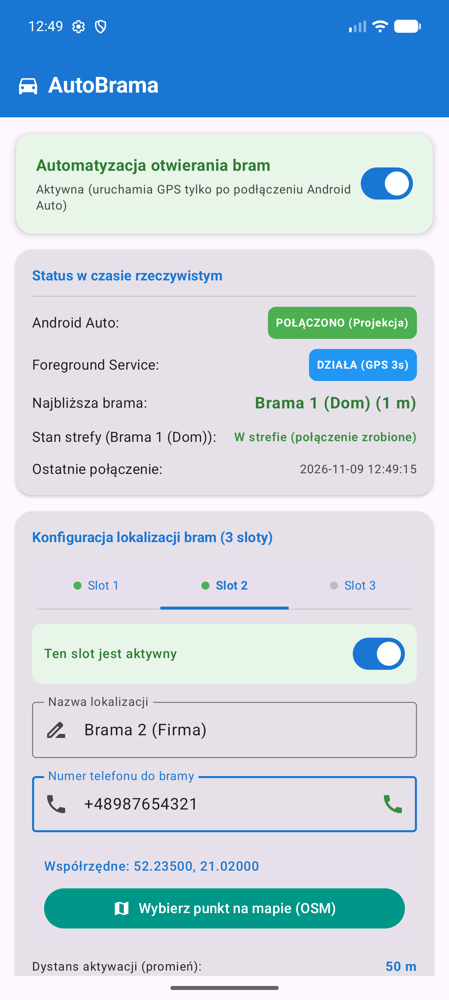
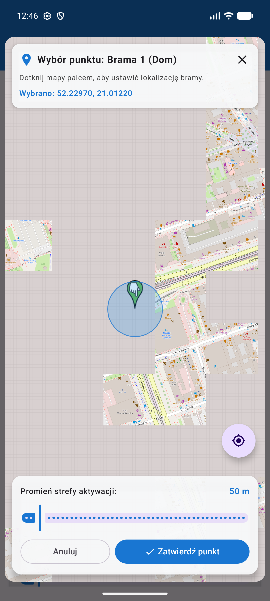
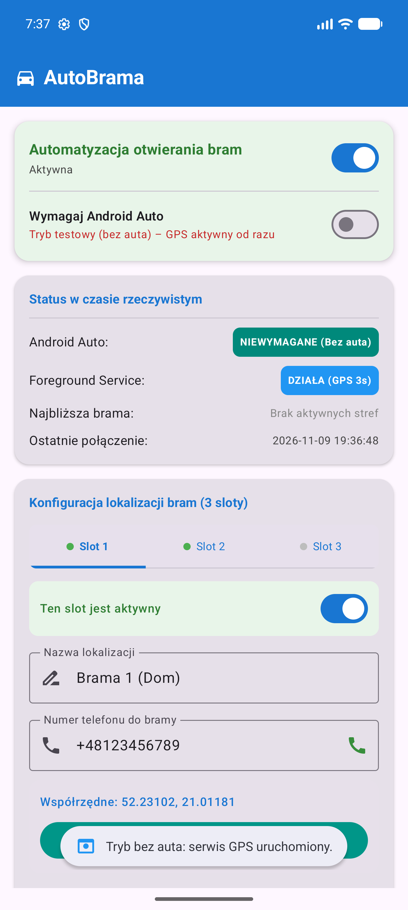

# AutoBrama (AndroidBrama) 🚗🚪📞

**AutoBrama** to inteligentna aplikacja dla systemu Android automatyzująca otwieranie bram wjazdowych, szlabanów i garaży za pomocą połączenia telefonicznego (GSM/CLIP). Aplikacja monitoruje lokalizację GPS w tle i po wjechaniu w zdefiniowany promień automatycznie wybiera numer telefonu przypisany do danej bramy.

Dzięki integracji z **Android Auto** aplikacja może uruchamiać śledzenie GPS **wyłącznie wtedy, gdy telefon jest połączony z samochodem**, zapewniając natychmiastowe otwarcie bramy oraz zerowe zużycie baterii poza pojazdem. Posiada również przełącznik trybu testowego do działania bez auta.

---

## 📱 Zrzuty ekranu

| Ekran główny (Sloty i status na żywo) | Wybór punktu na mapie OpenStreetMap | Tryb testowy (bez auta) |
|:---:|:---:|:---:|
|  |  |  |

---

## ✨ Główne funkcjonalności

1. **Obsługa 3 niezależnych lokalizacji (slotów):**
   - Każdy slot posiada:
     - Własną edytowalną nazwę (np. *Dom*, *Firma*, *Działka*),
     - Dedykowany numer telefonu z przyciskiem szybkiego testu połączenia,
     - Indywidualne współrzędne geograficzne (szerokość i długość),
     - Niezależny suwak promienia aktywacji (od 20 m do 500 m),
     - Przełącznik aktywności slotu.

2. **Interaktywny wybór na mapie (OpenStreetMap / `osmdroid`):**
   - Pełna funkcjonalność mapy bez konieczności posiadania płatnego klucza Google Maps API.
   - Automatyczne centrowanie na bieżącej pozycji GPS z dużym powiększeniem (zoom 18.0).
   - Wskazywanie punktu bramy bezpośrednio tapnięciem palca na mapie.
   - Wizualizacja strefy aktywacji w postaci dynamicznego okręgu o zadanym promieniu.

3. **Optymalizacja baterii i detekcja Android Auto:**
   - Wykorzystanie biblioteki `androidx.car.app.connection` (`CarConnection`).
   - Usługa śledzenia GPS uruchamia się automatycznie w momencie projekcji ekranu w aucie (`CONNECTION_TYPE_PROJECTION`) i natychmiast wyłącza po rozłączeniu.
   - **Przełącznik „Wymagaj Android Auto”**: możliwość wyłączenia wymogu samochodu jednym kliknięciem w celu przetestowania działania pieszo lub w emulatorze.

4. **Niezawodna usługa w tle (`Foreground Service`):**
   - Działa jako usługa typu `location` (`FOREGROUND_SERVICE_TYPE_LOCATION`) z powiadomieniem ciągłym.
   - Odczyt pozycji przez `FusedLocationProviderClient` z priorytetem `PRIORITY_HIGH_ACCURACY` co 3 sekundy.
   - Ciągłe powiadomienie informuje kierowcę o najbliższej bramie i odległości w czasie rzeczywistym.

5. **Zabezpieczenie przed pętlą połączeń (Maszyna Stanów + Histereza):**
   - Dedykowana instancja `GateTriggerStateMachine` dla każdego aktywnego slotu.
   - Połączenie telefoniczne wykonywane jest **tylko raz** po wjechaniu w strefę (`dystans <= promień`).
   - Ponowne wyzwolenie następuje dopiero po opuszczeniu strefy na bezpieczną odległość (`promień + 150 metrów`), co zapobiega powtarzaniu połączeń podczas manewrowania pod bramą.

6. **Nowoczesny interfejs w Jetpack Compose (Material 3):**
   - Reaktywne zakładki dla slotów (`TabRow`).
   - Karta statusu połączenia i odległości na żywo.
   - Zapis danych w reaktywnym `Jetpack DataStore Preferences`.

---

## 🛠️ Architektura projektu

```
com.autobrama.app
├── connection
│   └── CarConnectionManager.kt      # Obserwator stanu projekcji Android Auto
├── data
│   ├── GateLocationSlot.kt          # Model 3 slotów bram z obsługą JSON
│   └── PreferencesManager.kt        # Magazyn ustawień Jetpack DataStore Preferences
├── receiver
│   └── CarConnectionReceiver.kt     # Odbiornik systemowych zdarzeń CarConnection
├── service
│   ├── ActiveGateStatus.kt          # Model stanu najbliższej bramy dla UI i powiadomień
│   └── AutoCallForegroundService.kt # Usługa Foreground GPS + obsługa maszyn stanów
├── statemachine
│   └── GateTriggerStateMachine.kt   # Maszyna stanów z histerezą (+150 m)
└── ui
    ├── MainActivity.kt              # Główny ekran Compose (Material 3)
    ├── MainViewModel.kt             # ViewModel zarządzający stanem i logiką
    └── MapPickerDialog.kt           # Pełnoekranowy dialog mapy OpenStreetMap (osmdroid)
```

---

## 🔒 Wymagane uprawnienia

Aplikacja deklaruje w `AndroidManifest.xml` następujące uprawnienia:
- `ACCESS_FINE_LOCATION` / `ACCESS_COARSE_LOCATION` – precyzyjny odczyt GPS do detekcji strefy bramy.
- `FOREGROUND_SERVICE` & `FOREGROUND_SERVICE_LOCATION` – działanie w tle z typem lokalizacji.
- `CALL_PHONE` – automatyczne wykonywanie połączenia telefonicznego pod numer bramy (`Intent.ACTION_CALL`).
- `POST_NOTIFICATIONS` – wyświetlanie stałego powiadomienia o stanie monitorowania (Android 13+).
- `INTERNET` & `ACCESS_NETWORK_STATE` – pobieranie kafelków mapy OpenStreetMap.

---

## 🚀 Kompilacja i uruchomienie

### Wymagania:
- **Android Studio** (Ladybug / Iguana lub nowszy)
- **JDK 17+** (zalecany wbudowany JBR Android Studio)
- **Android SDK:** `compileSdk 36`, `targetSdk 36`, `minSdk 26` (Android 8.0+)

### Budowanie z linii poleceń:

1. **Skompilowanie wersji debug i uruchomienie testów jednostkowych:**
   ```bash
   ./gradlew test assembleDebug
   ```

2. **Skompilowanie podpisanej wersji Release (APK):**
   ```bash
   ./gradlew assembleRelease
   ```
   Wygenerowany plik APK znajdziesz w: `app/build/outputs/apk/release/app-release.apk`

3. **Skompilowanie paczki Google Play Bundle (AAB):**
   ```bash
   ./gradlew bundleRelease
   ```
   Wygenerowany plik AAB znajdziesz w: `app/build/outputs/bundle/release/app-release.aab`

4. **Instalacja na urządzeniu / emulatorze przez ADB:**
   ```bash
   adb install -r app/build/outputs/apk/release/app-release.apk
   ```

---

## 🧪 Testowanie bez samochodu

1. Na ekranie głównym aplikacji upewnij się, że przełącznik **„Wymagaj Android Auto”** jest wyłączony.
2. Włącz główny przełącznik **„Automatyzacja otwierania bram”**.
3. Na pasku powiadomień pojawi się ikona usługi informująca o monitorowaniu strefy.
4. Możesz przetestować wjazd w strefę pieszo lub w emulatorze, wysyłając koordynaty GPS:
   ```bash
   adb emu geo fix <długość_geo> <szerokość_geo>
   ```

---

## 📄 Licencja

Projekt udostępniony na licencji MIT (lub dowolnej wybranej przez autora).
